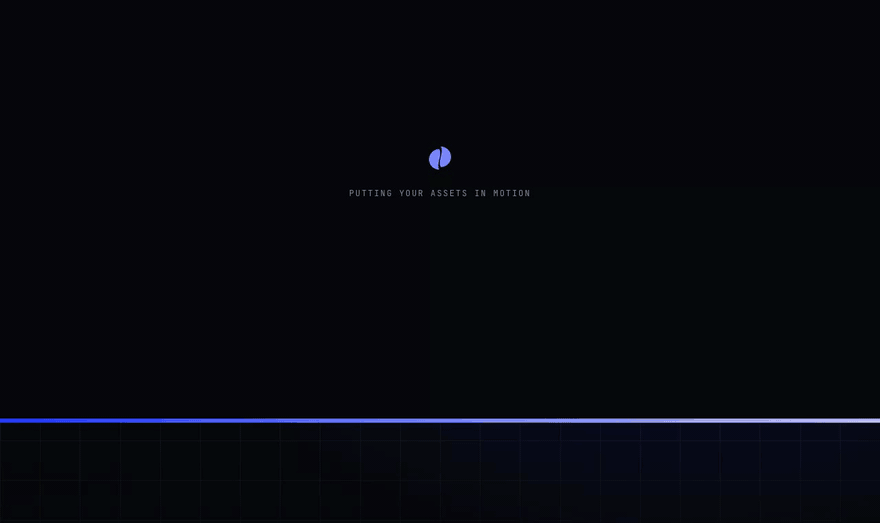
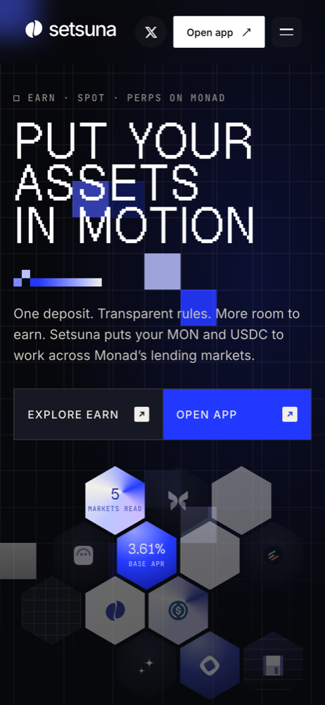
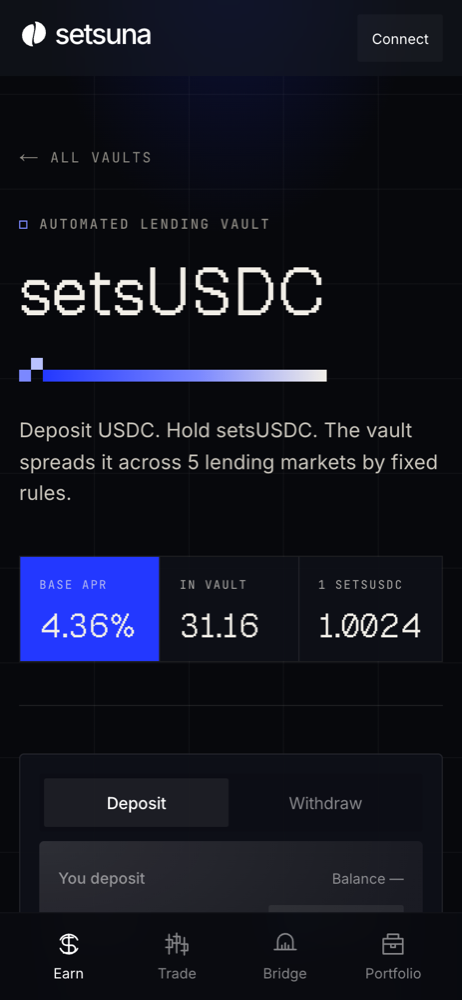
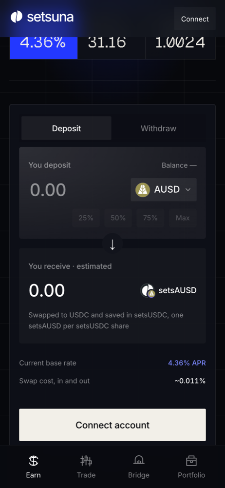
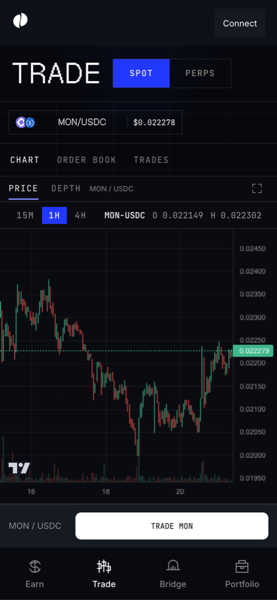
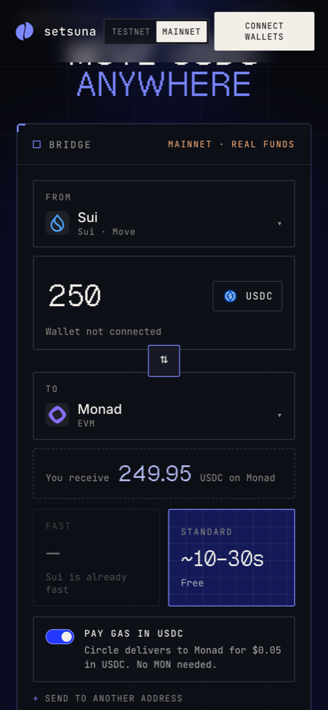
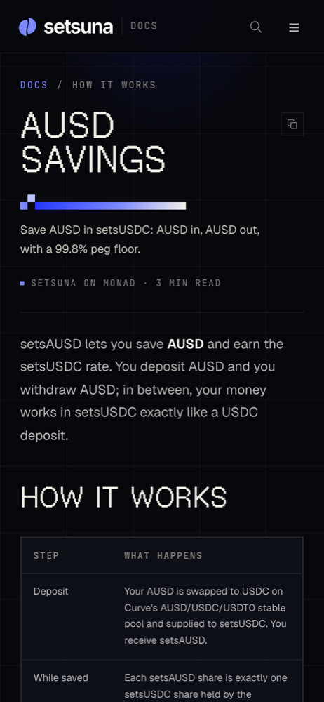

<p align="center">
  
</p>

<p align="center">
  <a href="https://setsuna.finance"><b>App</b></a> ·
  <a href="https://setsuna.finance/docs/"><b>Docs</b></a> ·
  <a href="https://bridge.setsuna.finance"><b>Bridge</b></a> ·
  <a href="https://www.npmjs.com/package/@setsunaprotocol/sdk"><b>SDK</b></a> ·
  <a href="https://www.npmjs.com/package/@setsunaprotocol/mcp"><b>MCP</b></a> ·
  <a href="https://x.com/Setsunaprotocol"><b>X</b></a>
</p>

<p align="center">
  
  
  <a href="https://www.npmjs.com/package/@setsunaprotocol/sdk"></a>
  <a href="https://www.npmjs.com/package/@setsunaprotocol/mcp"></a>
  <a href="LICENSE"></a>
</p>

<p align="center">
  <b>Rule-bound Earn vaults on Monad.</b><br>
  Deposit USDC, MON or AUSD. The vault spreads it across Monad's lending markets by fixed onchain<br>
  rules, anyone can trigger a rebalance, and no admin can move your funds or set the rate.
</p>

<p align="center">
  
  <br>
  <sub>The live site: the hexagons cycle through live reads from the vaults and the markets they lend to.</sub>
</p>

Live on **Monad mainnet** at [setsuna.finance](https://setsuna.finance). Earn is a capped beta with
real funds, and the contracts are **unaudited**: deposit only what you can afford to lose.

## What it does

<table>
  <tr>
    <td width="33%" valign="top">
      <br>
      <b>One deposit, five markets</b><br>
      Put USDC or MON to work across Aave, Morpho, Euler, Neverland and Curvance. The contract
      decides the split; you hold one share token.
    </td>
    <td width="33%" valign="top">
      <br>
      <b>Rules you can read</b><br>
      setsUSDC (cap 2,000 USDC) and setsMON (cap 25,000 MON) show the live rate, what's in the
      vault and what one share is worth. A 2% fee comes from yield, never principal.
    </td>
    <td width="33%" valign="top">
      <br>
      <b>Save AUSD</b><br>
      AUSD in, AUSD out through Curve, earning the setsUSDC rate, with a 99.8% peg floor. Apps can
      let savers deposit by signature while a relayer pays the gas.
    </td>
  </tr>
  <tr>
    <td width="33%" valign="top">
      <br>
      <b>Spot and perps</b><br>
      MON/USDC spot on Kuru, limit orders, BTC perps on Perpl, and an in-app swap routed for the
      best price across Monad.
    </td>
    <td width="33%" valign="top">
      <br>
      <b>USDC from 28 chains</b><br>
      Native USDC over Circle CCTP V2 at <a href="https://bridge.setsuna.finance">bridge.setsuna.finance</a>.
      Turn on "Pay gas in USDC" and Circle delivers it, with no gas needed on Monad.
    </td>
    <td width="33%" valign="top">
      <br>
      <b>Built to build on</b><br>
      Every rule is documented at <a href="https://setsuna.finance/docs/">setsuna.finance/docs</a>.
      The SDK and MCP server let apps and AI clients read vaults and prepare deposits users sign.
    </td>
  </tr>
</table>

## How Earn works

1. You deposit and receive vault shares (`setsUSDC`, `setsMON`, `setsAUSD`). Interest raises the
   value of each share; nobody mints you extra.
2. Anyone can record each market's rate. A market whose rate jumps between readings is skipped.
3. Anyone can call `rebalance()`. The contract alone decides the allocation, within fixed limits:
   at most 60% in one market, at most 10% of a market's cash, at most 10% of the vault moved at once,
   and 10% kept as cash for withdrawals.
4. Withdrawals draw first from the lowest-yielding market. A 2% fee is taken from yield, never principal.

The guardian can only pause deposits or disable a market. It cannot move funds. Details:
[how it works](https://setsuna.finance/docs/how-it-works/overview/) and
[architecture](docs/ARCHITECTURE-V2.md).

## Contracts (Monad mainnet, chain 143)

| Contract | Address |
|---|---|
| setsUSDC vault | [`0x0a531817EEFB7b1FFD7c511c0817F58ac343CC67`](https://monadscan.com/address/0x0a531817EEFB7b1FFD7c511c0817F58ac343CC67) |
| setsMON vault | [`0x408A8C85a3e15446885ADCc954575e7a918dFd33`](https://monadscan.com/address/0x408A8C85a3e15446885ADCc954575e7a918dFd33) |
| Native MON gateway | [`0x34fAFC57C6B086bC31a32693BDA0260c85Ff5BB3`](https://monadscan.com/address/0x34fAFC57C6B086bC31a32693BDA0260c85Ff5BB3) |
| setsAUSD | [`0x551903E3687820A733FBe406DD33Fee8D12bd2F3`](https://monadscan.com/address/0x551903E3687820A733FBe406DD33Fee8D12bd2F3) |
| SetsunaAUSDSaver | [`0x4cbf5688cc98BCb76CcAB602AFc7b6fD57863cC3`](https://monadscan.com/address/0x4cbf5688cc98BCb76CcAB602AFc7b6fD57863cC3) |
| Spot gateway (Kuru) | [`0x978BdBaD035F1cdf47e10915c0ceC4A94C3fC17D`](https://monadscan.com/address/0x978BdBaD035F1cdf47e10915c0ceC4A94C3fC17D) |
| Limit-order factory | [`0x323ad3cd45Cc366306B60878b59ED0d6C56EEfA4`](https://monadscan.com/address/0x323ad3cd45Cc366306B60878b59ED0d6C56EEfA4) |
| Perpl account factory | [`0x00206Efbf5C49B61f2701a20d86329df4C3aB50D`](https://monadscan.com/address/0x00206Efbf5C49B61f2701a20d86329df4C3aB50D) |

Source for each is verified on [Sourcify](https://sourcify.dev/). Lending destinations and
assets: [networks and contracts](src/content/docs/developers/contracts.md).

## Build on it

```sh
npm install @setsunaprotocol/sdk
```

```ts
import { createSetsuna } from "@setsunaprotocol/sdk";

const setsuna = createSetsuna(); // Monad mainnet, read-only, no key
const vaults = await setsuna.getVaults(); // rates, allocations, room under the cap
const savings = await setsuna.ausd.getSavings(); // AUSD savings for your users
```

Connect an AI client to the hosted MCP server:

```sh
claude mcp add --transport http setsuna https://mcp.setsuna.finance/mcp
```

Gas-free AUSD savings for apps: [integration guide](https://setsuna.finance/docs/developers/ausd-savings/).

## Repository

| Path | Contents |
|---|---|
| [`src/`](src) | The Next.js app at setsuna.finance: Earn, Trade, Portfolio and the docs site |
| [`contracts/`](contracts) | Solidity vaults, adapters, gateway, AUSD wrapper and saver (Foundry) |
| [`bridge/`](bridge) | The CCTP V2 bridge app at bridge.setsuna.finance |
| [`packages/sdk`](packages/sdk), [`packages/mcp`](packages/mcp) | The published SDK and MCP server |
| [`relayer/`](relayer) | Gas relayer for signed setsAUSD deposits and withdrawals |
| [`scripts/`](scripts) | Keepers, deployment and verification scripts |
| [`stats/`](stats) | The private real-usage dashboard |
| [`docs/`](docs) | Engineering notes, research and deployment records |

## Run it locally

Node.js 24. Copy `.env.example` to `.env.local` and add the public `SETSUNA_MAINNET_EARN` and
`SETSUNA_MAINNET_TRADING` manifests ([configuration](docs/LIVE-DEPLOYMENT.md)).

```sh
npm ci
npm run dev        # http://localhost:3000
```

Without manifests the app shows read-only markets. With them, wallet transactions use **real
mainnet funds**, even locally.

```sh
npm run typecheck && npm run build
npm run test:earn-keeper && npm run test:keeper && npm run test:markets && npm run test:portfolio
npm run setup:contracts && npm run contracts:test    # Foundry; local mocks, no RPC needed
```

The Earn keepers are separate processes that observe rates and submit permissionless actions:
[running a keeper](src/content/docs/developers/keepers.md).

## Contributing and security

Read [CONTRIBUTING.md](CONTRIBUTING.md) before opening a pull request. Report vulnerabilities
privately as described in [SECURITY.md](SECURITY.md), never in a public issue.

## License

[MIT](LICENSE).
